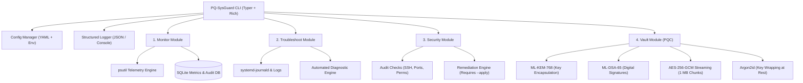
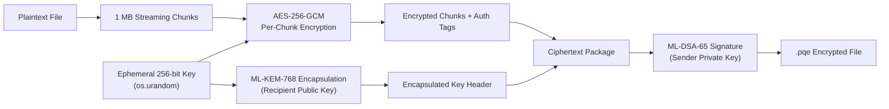

# PQ-SysGuard Architecture & System Design

PQ-SysGuard is a modular Linux system-administration and security toolkit built with zero-trust principles and NIST post-quantum cryptographic standards.

---

## 1. High-Level Architecture

The toolkit consists of four core functional modules, supported by common utilities for structured configuration, JSON logging, and persistent SQLite auditing.

---

## 2. Core Modules Description

| Module | Primary Responsibility | Key Components | State / Safety Defaults |
| :--- | :--- | :--- | :--- |
| **`monitor`** | Server health telemetry | CPU, RAM, Disk, Network, Process table | Read-only |
| **`troubleshoot`** | Root cause automated triage | Log analysis, service failure detection, OOM inspection | Read-only |
| **`security`** | Hardening verification & remediation | SSH daemon config, open ports, permissions, update status | **Read-only by default**; `--apply` required for changes |
| **`vault`** | Post-quantum file protection | ML-KEM-768, ML-DSA-65, chunked AES-256-GCM | Ephemeral symmetric file key; zeroized buffers |

---

## 3. Post-Quantum Vault: Hybrid Cryptographic Flow

The vault guarantees resilience against future cryptanalytically relevant quantum computers ("Harvest Now, Decrypt Later" attack vectors).

### Encryption Pipeline

### Key Encapsulation & Authentication Specification
1. **Symmetric File Key**: 256-bit ephemeral key generated using `os.urandom()`.
2. **Bulk Encryption**: AES-256-GCM streaming in 1 MB chunks with unique nonces and authenticated chunk counters to prevent reordering, truncating, or replay attacks.
3. **Key Encapsulation**: The ephemeral symmetric key is encapsulated to recipient's public key using **ML-KEM-768** (FIPS 203).
4. **Package Authentication**: The header and chunk authentication manifests are signed using **ML-DSA-65** (FIPS 204) private key.
5. **Private Key Storage at Rest**: Private keys on disk are encrypted using **Argon2id** (memory cost: 64 MB, time cost: 3 iterations) and **AES-256-GCM**.

---

## 4. Non-Negotiable Security Architecture

1. **Strictly Parameterized Subprocesses**: Never use `shell=True`. All system inquiries and remediations execute with fixed argument arrays (`execve` semantics) and input validation.
2. **Explicit Consent for Changes**: Security audits and troubleshooting are strictly observational unless the operator passes `--apply`.
3. **Memory Hygiene**: Ephemeral symmetric keys and plaintext buffers are explicitly overwritten (`bytearray` zeroization) as soon as operations conclude.
4. **Structured JSON Auditability**: All operational actions are logged as structured JSON with automatic redaction of sensitive credentials and keys.
